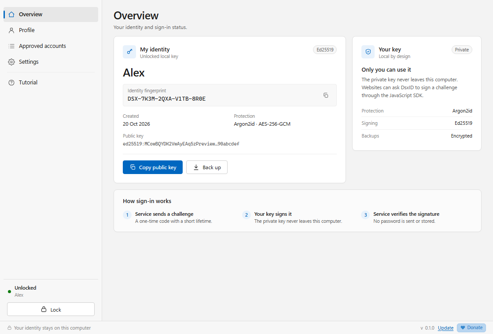
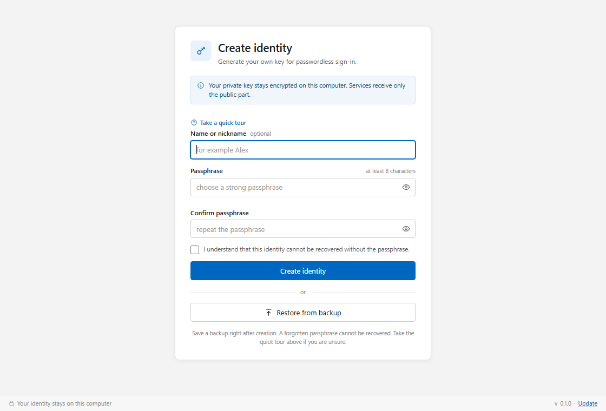
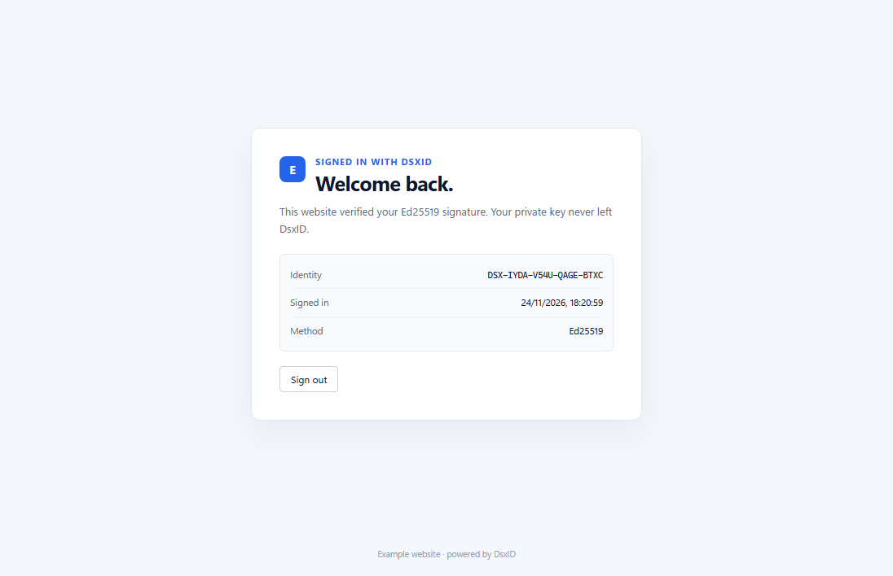
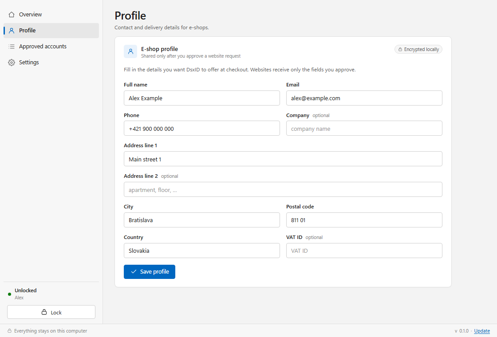
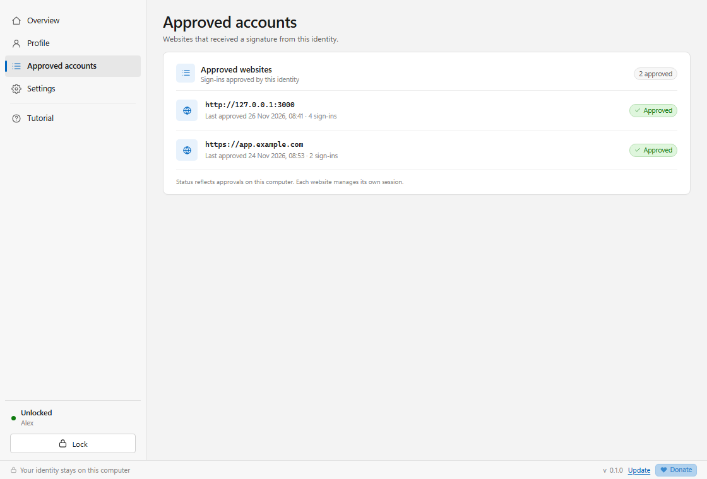
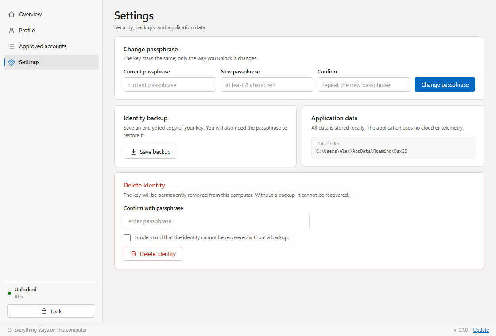

# DsxID

> **Sign in as yourself.** A local identity for your computer.

Created by **Damián Sýkora**.

DsxID is a small Go desktop application that gives your identity its own
cryptographic key. The key is generated locally, encrypted with your passphrase,
and never leaves the computer. Websites can request a signature through a small
JavaScript SDK; every request is approved in the desktop app.

No email. No password stored on a server. No cloud.



## What it does

- **Your own identity** — an Ed25519 key pair with a `DSX-XXXX-XXXX-XXXX-XXXX` fingerprint.
- **Encrypted vault** — the private key is sealed with Argon2id + AES-256-GCM.
- **Website sign-in** — a JavaScript SDK and local approval bridge for real website sessions.
- **Windows notifications** - a toast appears when a website asks for approval, even if the window is in the background.
- **Tray icon** - closing the window keeps DsxID running in the Windows notification area. The tray menu can open it, lock the identity, or quit.
- **E-shop profile** - prefill contact and delivery details locally; approved websites receive only the fields you confirm.
- **Approved accounts** - a local list of websites that received a signature from this identity.
- **Backups** — an encrypted file that can be restored with the same passphrase.
- **Lock** — a single click removes the unlocked key from memory.



## Quick start

1. Run `DsxID.exe`.
2. Create an identity and choose a passphrase (at least 8 characters; longer is better).
   Closing the window keeps DsxID running in the Windows notification area; use
   the tray menu to open, lock, or quit.
3. **Save a backup immediately** using the *Back up* button.
4. Add the web SDK to your site, or run the included example:

```powershell
node web-sdk/example/server.js
```

Open `http://127.0.0.1:3000`, click **Sign in with DsxID**, and approve the
request in the DsxID window. The website will show your key fingerprint.

The desktop app must be running and unlocked while the website asks for a
signature.



See [`web-sdk/README.md`](web-sdk/README.md) for the JavaScript SDK, backend
contract, and security notes.

### E-shop profile

The **Profile** page stores optional checkout details: name, email, phone,
company, address, city, postal code, country, and VAT ID. The profile is
encrypted with a key derived from the unlocked identity private key; while
DsxID is locked, the profile cannot be read.

A website asks for specific field names through the SDK. DsxID shows every
requested field and value in the approval dialog, and only fields that are
saved and approved are signed into the short-lived assertion. The website can
then prefill its checkout form. See the SDK docs for an example.

The profile is stored separately from the identity backup; after restoring an
identity on another computer, fill the profile again.



### Approved accounts

Every approved website sign-in is recorded locally. **Approved accounts** shows
the website origin, an approval status, the last approval time, and the number of
sign-ins for the current identity. The actual browser session stays with the
website; this page is a local history.



### Settings

Settings holds passphrase changes, encrypted backups, and the local data folder.
The application window has a fixed size, so the layout stays consistent.

The **Update** link beside the version at the bottom of the window shows the
current version. Set `UPDATE_URL` in `frontend/dist/app.js` to the public
download page when it becomes available.



## How it works

1. A website creates a random challenge and stores it in the visitor's session.
2. The browser SDK sends the challenge to the DsxID bridge at `127.0.0.1:41991`.
3. DsxID shows the actual website origin and waits for your approval.
4. After approval, DsxID signs the website origin + challenge with Ed25519.
5. The browser sends the assertion to the website backend.
6. The backend verifies the signature and creates a normal session cookie.

Assertion format:

```
dsx1.<base64url(payload JSON)>.<base64url(signature)>
```

The signature covers `dsxid-auth-v1.` + the payload. The payload contains the
version, type, `kid`, `aud`, a one-time `nonce`, `iat`, and `exp`. The website
must verify the origin, challenge, key fingerprint, signature, and expiry. The
Node helper in [`web-sdk/dsxid-verify.js`](web-sdk/dsxid-verify.js) implements
these checks.

| Part | Mechanism |
|---|---|
| Identity and signature | Ed25519 |
| Private-key protection | Argon2id (64 MiB, 3 iterations) + AES-256-GCM |
| Challenge | 32 random bytes, short-lived, single-use |
| Identifier | first 80 bits of SHA-256 of the public key, Base32 |

Application data lives in `%APPDATA%\DsxID`:

- `identity.json` — encrypted private key,
- `profile.json` — encrypted e-shop profile,
- `approved.json` — local list of websites approved with this identity,
- `dsxid.log` — a short operational log.

> **The passphrase cannot be recovered.** Nobody — including this application —
> keeps a copy of your key. Without the passphrase and a backup, the identity is
> gone. That is intentional.

## Landing page and SDK hosting

The public site is **[https://dsxid.org/](https://dsxid.org/)**, deployed to
GitHub Pages by [`.github/workflows/pages.yml`](.github/workflows/pages.yml)
from the `landing/` folder only. The browser SDK is served at
`https://dsxid.org/sdk/dsxid.js`, and the Windows build at
`https://dsxid.org/download/DsxID.exe`.

`landing/index.html` is a static product page using the same light Windows
surfaces, Segoe UI typography, thin borders, and blue accent as the app. It is
responsive and needs no build step. Preview it with:

```powershell
npx.cmd --yes serve landing
```

Then open `http://localhost:3000/`. The page is in English, matching the
application UI. See [`landing/README.md`](landing/README.md) for the GitHub
Pages setup, custom-domain DNS records, and the download/SDK publishing steps.

## Security boundaries

DsxID protects you from websites holding your password or private key. When a
site requests profile fields, the desktop dialog shows exactly which saved
values will be shared; they are signed into the same origin-bound assertion.
It does not protect a compromised computer, a keylogger, malware, or phishing that
convinces you to approve a malicious challenge. Always read the website origin
in the approval dialog and only approve sign-ins you started.

The bridge listens on IPv4 loopback only. It requires an explicit approval in the
desktop app for every signature; it never exposes the private key to the page.
The application has no telemetry and makes no external network calls.

### Man-in-the-middle protection

- The browser SDK refuses to start a sign-in on a page that is neither HTTPS nor
  `localhost`.
- The local bridge rejects `http://` website origins outside loopback, so an
  insecure HTTP site cannot obtain a signature even if the SDK is modified.
- The signed assertion covers the website origin and one-time challenge. The
  website backend must verify both, reject expired assertions, and consume the
  challenge once. A network attacker cannot forge the Ed25519 signature.
- The local bridge is loopback-only. Malware already running on the computer is
  outside this threat model; always read the website origin in the approval
  dialog.

HTTP is allowed only for localhost development. Production websites must use
HTTPS and a `Secure` session cookie.

The local bridge is intended for development and local sites. HTTPS sites may be
subject to mixed-content or Private Network Access restrictions when calling a
local HTTP bridge. For production, use a custom app link, a browser extension,
or a hosted relay. The signature format remains the same.

## Build from source

Requirements: Go 1.26+, [Wails CLI](https://wails.io) 2.17, and WebView2 (already
present on most Windows 10/11 systems). Node.js is only needed for the example
website and the SDK helper. The desktop frontend is plain HTML/CSS/JS.

```powershell
go install github.com/wailsapp/wails/v2/cmd/wails@v2.17.1
.\scripts\build.cmd
```

(`scripts\build.cmd` bypasses the Windows Execution Policy; to run the PowerShell
script directly, use `powershell -ExecutionPolicy Bypass -File .\scripts\build.ps1`.)

Or build manually:

```powershell
wails build -clean -s -skipbindings -trimpath -nopackage
```

The result is `build/bin/DsxID.exe`; the build script also copies it to the
project root and to `landing/download/DsxID.exe`, which is the published
download on dsxid.org.

Tests:

```powershell
go test ./...
go vet ./...
```

Development build with a console log:

```powershell
go build -tags production -o DsxID-dev.exe .
.\DsxID-dev.exe
```

To test with isolated data, set `DSXID_DATA_DIR`:

```powershell
$env:DSXID_DATA_DIR = "$env:TEMP\dsxid-dev"
.\DsxID-dev.exe
```

### Windows icon, manifest, and file properties

`rsrc_windows_amd64.syso` embeds the application icon, DPI-aware Windows
manifest, and version metadata into the executable. It is generated from
`build/appicon.ico`, `build/windows/app.manifest`, and
`build/windows/versioninfo.json`. The original supplied logo is kept at
`build/logo-source.png`:

```powershell
go install github.com/josephspurrier/goversioninfo/cmd/goversioninfo@v1.7.0
goversioninfo -icon build/appicon.ico -manifest build/windows/app.manifest -o rsrc_windows_amd64.syso build/windows/versioninfo.json
```

`versioninfo.json` fills the File description, File version, Product name,
Product version, Copyright, and Language fields in the Windows file Properties
dialog.

## Project structure

```
main.go                     Wails entrypoint and embedded frontend
scripts/                    build scripts
internal/app                application state, approvals, icon, tray, tests
internal/identity           key generation and encryption
internal/protocol           assertion format and signature verification
internal/bridge             localhost signing bridge for websites
internal/approvals          local approved-account history
internal/profile            encrypted e-shop profile
web-sdk/                    browser SDK (obfuscated + source), verifier, example
landing/                    dsxid.org landing page, hosted SDK, and download
.github/workflows/pages.yml GitHub Pages deployment
frontend/dist               desktop UI (static, no build step)
docs/screenshots            README screenshots
build/logo-source.png       original supplied logo
build/windows/app.manifest  Windows manifest
build/windows/versioninfo.json  Windows file properties and version metadata
rsrc_windows_amd64.syso     embedded icon, manifest, and version metadata
```

## License

MIT.
